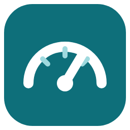
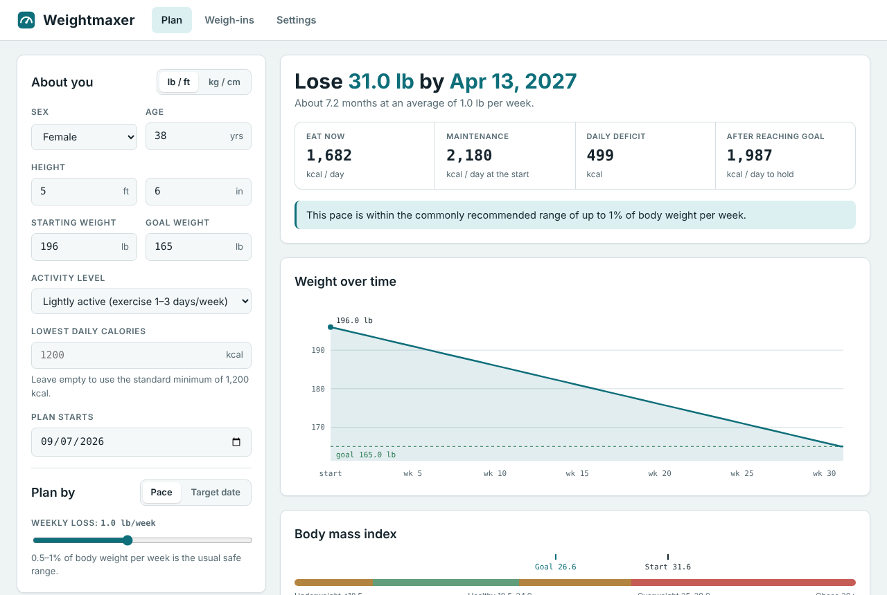
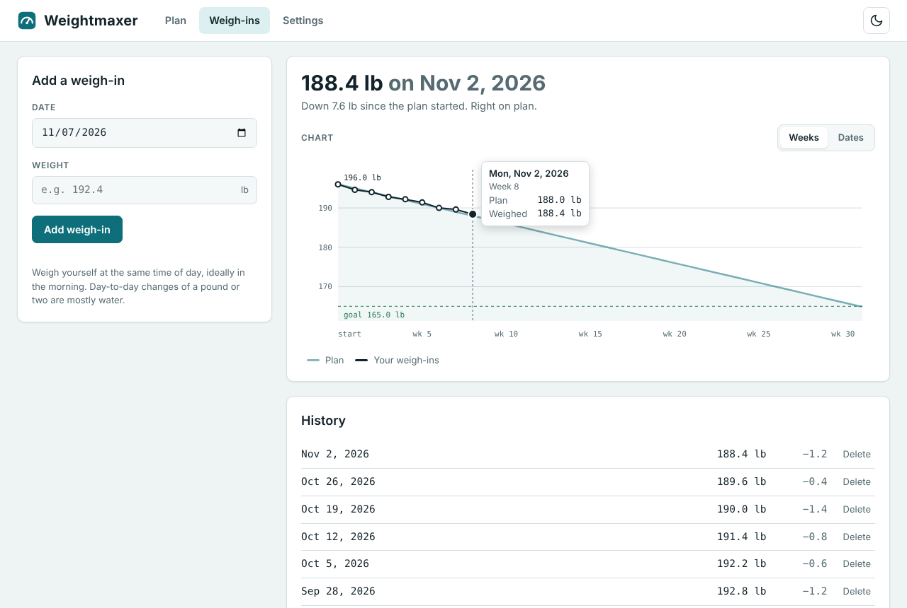
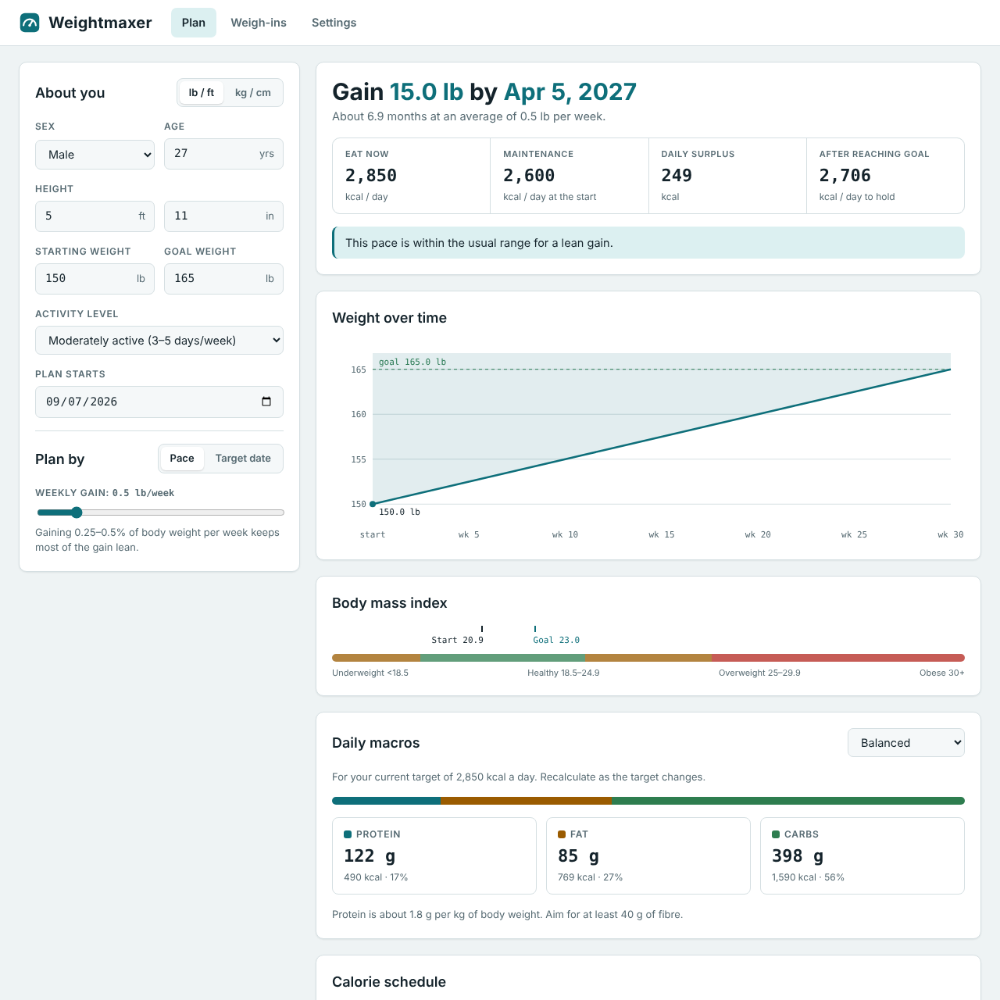
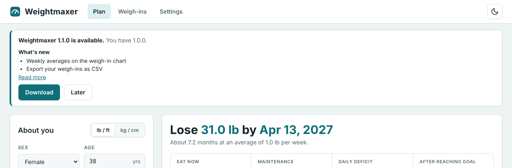

<div align="center">
  
  <h1>Weightmaxer</h1>
  <p>Plan how long it takes to lose or gain weight, what to eat each day, and track your weigh-ins against the plan.</p>
  <p>
    <a href="#download">Download</a> ·
    <a href="#getting-started">Get started</a> ·
    <a href="#features">Features</a> ·
    <a href="#screenshots">Screenshots</a> ·
    <a href="#updates-and-settings">Updates</a> ·
    <a href="#development">Development</a>
  </p>
  
</div>

## Features

Weightmaxer is a small Windows app, also available as a [web version](https://techsavage1989.github.io/weightmaxer/), for anyone planning a weight change. Enter your sex, age, height, weight, goal and activity level, and it works out a realistic timeline and daily calories, then helps you stay on track.

- **Lose or gain weight.** Set a goal below or above your starting weight. Plan by weekly pace or by a target date.
- **Daily calories that adjust.** Your target changes as your weight changes, shown week by week in a calorie schedule.
- **Your own calorie minimum.** Plans never go below 1,200 kcal (women) or 1,500 kcal (men) unless you set a lower minimum, down to 800 kcal, which shows a warning to get medical advice.
- **Macro targets.** Daily protein, fat and carbohydrate in grams for Balanced, Lower carb or Lower fat eating, plus a fibre target.
- **Weigh-in log.** Record your weight and see it plotted against the plan, with how far ahead or behind you are.
- **Safety warnings.** Weightmaxer flags paces faster than 1% of body weight per week, and goals in the underweight or obese range.
- **Private.** Your data stays on your device. The Windows app's only network request is the update check to GitHub; the web version sends nothing anywhere after the page loads.

The numbers are estimates (Mifflin–St Jeor and about 3,500 kcal per pound), not medical advice.

## Screenshots

**Track weigh-ins against your plan**



**Plan a weight gain, with daily macros**



**Updates show what's new and wait for you**



## Download

Get **`Weightmaxer-win-x64.zip`** from the [latest release](https://github.com/TechSavage1989/weightmaxer/releases/latest). It contains `Weightmaxer.exe`, a short `README.txt` and third-party notices. Every release also has a `SHA256SUMS.txt` you can check the zip against.

All versions, including any preview builds, are on the [releases page](https://github.com/TechSavage1989/weightmaxer/releases).

**No install needed:** the [web version](https://techsavage1989.github.io/weightmaxer/) has the same planner, macros and weigh-in log in any modern browser, on phones as well as computers. It saves your data in that browser only; use **Settings › Export data** to keep a copy or move it to another device.

## Requirements

- 64-bit Windows 10 or Windows 11 (x64). Windows on ARM and 32-bit Windows aren't supported.
- Microsoft Edge WebView2 Runtime, which is included with current Windows. If it's missing, Weightmaxer tells you where to get it.
- No administrator rights and no installer.
- The web version needs a current Chrome, Edge, Firefox or Safari with site storage allowed.

Automated tests run on GitHub's Windows Server machines. Testing by hand on Windows 10 and 11 desktops is still to be done; please open an issue if something doesn't work.

## Getting started

1. Download `Weightmaxer-win-x64.zip` from the [latest release](https://github.com/TechSavage1989/weightmaxer/releases/latest).
2. Right-click the zip, choose **Extract All**, and pick a folder you own, such as `Documents\Weightmaxer`. Avoid `Program Files`, because Weightmaxer can't update itself there.
3. Double-click `Weightmaxer.exe`. Weightmaxer isn't code-signed yet, so the first time Windows SmartScreen may show **Windows protected your PC**. Choose **More info**, then **Run anyway**.
4. Optional: right-click `Weightmaxer.exe` and choose **Pin to Start** or **Send to › Desktop (create shortcut)**. Updates keep the same file, so shortcuts keep working.

## How to use

**Plan.** Fill in **About you** with your sex, age, height, starting weight, goal weight and activity level. Choose **lb / ft** or **kg / cm** at the top of the form.
- **Plan by › Pace** sets how much to lose or gain each week. **Target date** works out the pace from a date instead.
- **Lowest daily calories** is optional. Leave it empty for the standard minimum, or enter 800 kcal or more. Values below the standard minimum show a warning; eat that little only with a doctor's supervision.
- The results show your goal date, what to eat now, maintenance calories and your daily deficit or surplus. Below them are the weight chart, your BMI, **Daily macros** (pick a diet style in the card) and the week-by-week **Calorie schedule**.

**Weigh-ins.** Open **Weigh-ins**, pick a date, enter your weight and press **Add weigh-in**. Adding a second entry for the same date replaces the first. The chart compares your entries with the plan, and **History** lists them with the change since the previous one. Use **Delete** to remove an entry.

**Saving.** Everything saves automatically as you type. Nothing is uploaded.

**Web version.** Your data is kept in the browser you use, on that device. Private or incognito windows forget it when closed, and clearing site data erases it. **Settings › Export data** saves a `.json` file, and **Import data** loads one, including into another browser or device. The web version has no update banner; it's always the latest version when you open it.

## Updates and settings

Weightmaxer checks [this repository's releases](https://github.com/TechSavage1989/weightmaxer/releases) for a newer version:
- when it starts;
- every five minutes while its window is open and not minimized;
- when you come back to the window, if at least two minutes have passed since the last check.

Checks are cached, so an unchanged answer costs GitHub almost nothing. Weightmaxer also follows GitHub's limit of 60 checks an hour per network, waiting automatically when GitHub asks it to. If a check fails, **Settings › Updates** says so and shows when the last successful check was. It never claims you're up to date after a failed check. **Check now** checks right away, at most once a minute.

When a new version is available, a banner shows both version numbers and a short **What's new** list, with **Read more** when the release notes have more. Nothing downloads or installs until you choose:
1. **Download** fetches the zip from GitHub over HTTPS. It checks the file against the release's SHA-256 checksum and confirms it contains a 64-bit Weightmaxer program of exactly that version.
2. **Install and restart** closes Weightmaxer, keeps a backup of the current version, replaces `Weightmaxer.exe` (whatever you renamed it to) and starts the new version. If the new version doesn't open its window, the backup is put back and the old version starts again with an explanation. Finish any weigh-in you're typing first; Weightmaxer reminds you.

A matching checksum shows the file is the one published in this repository's release. It isn't a code-signing signature.

**Where files are kept:**

| What | Where |
| --- | --- |
| Your plan, weigh-ins and choices | `%APPDATA%\Weightmaxer\data.json` (plus `data.json.bak`, the previous save) |
| Update downloads, the backup of the previous version, logs, and the window's browser data | `%LOCALAPPDATA%\Weightmaxer\` |

Updating never touches your data. Release history is in [`docs/releases/`](docs/releases/).

The web version stores the same data in the browser's local storage for `techsavage1989.github.io`. It is redeployed automatically whenever a change reaches `main` and all checks pass.

## Troubleshooting

- **"Weightmaxer needs the Microsoft Edge WebView2 Runtime".** Install the Evergreen runtime from [Microsoft](https://developer.microsoft.com/microsoft-edge/webview2/) and start Weightmaxer again.
- **"Weightmaxer can't update itself in …".** The folder is read-only for your account (for example `Program Files`). Move `Weightmaxer.exe` to a folder such as `Documents` and start it from there, or download the new version yourself.
- **"Couldn't check for updates".** Check your internet connection. On a shared network GitHub may limit checks for a while; Weightmaxer waits and tries again.
- **An update didn't finish.** Weightmaxer restores the previous version automatically and says why. A copy of the previous version is in `%LOCALAPPDATA%\Weightmaxer\backup\`. Logs are in `%LOCALAPPDATA%\Weightmaxer\logs\`.
- **Starting fresh.** Close Weightmaxer and delete `%APPDATA%\Weightmaxer\data.json`. This erases your plan and weigh-ins.

## Development

Read [`AGENTS.md`](AGENTS.md) first, then [`DEVELOPMENT_HANDOFF.md`](DEVELOPMENT_HANDOFF.md) and the shared [repository standards](docs/REPOSITORY_STANDARDS.md). The updater design is described in [`docs/ARCHITECTURE.md`](docs/ARCHITECTURE.md).

Weightmaxer is written in Go with a WebView2 window ([go-webview2](https://github.com/jchv/go-webview2)). It cross-compiles from Linux, macOS or Windows without a C compiler. You need Go (version in `go.mod`), Python 3, and Node.js 22 for the browser tests.

```bash
python3 scripts/build.py
```

That builds `dist/Weightmaxer.exe`, `dist/Weightmaxer-win-x64.zip` and `dist/SHA256SUMS.txt`.

```bash
go test ./...
```

```bash
python3 -m unittest discover -s scripts -p "test_*.py" -v
```

```bash
npm ci --prefix tests && npm test --prefix tests
```

On Windows, the end-to-end update test installs an old build, updates it from a local HTTPS feed, and covers a tampered download and a rollback:

```bash
go test ./tests/e2e -v -timeout 25m
```

The website is built from the same `web/` files:

```bash
python3 scripts/build_site.py
```

That writes `site/index.html` and `site/icon.png`. Serve the folder with any static web server, for example `python3 -m http.server --directory site`.

GitHub Actions runs all of these on every push. A merge to `main` redeploys the website, and a new `VERSION` also publishes that version's Windows release.
